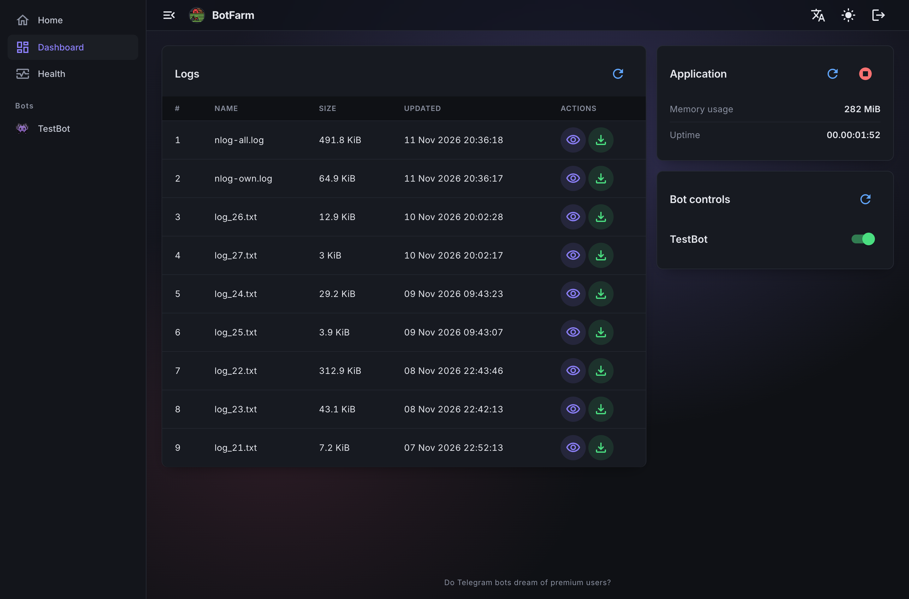
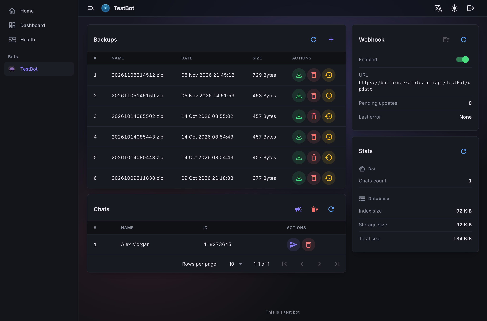

# TgBotFarm

A scalable multi-bot management platform for hosting and managing Telegram bots built with .NET 10, Blazor, and MongoDB.

## 🎯 Purpose

BotFarm is designed to host and manage multiple Telegram bots within a single application instance. It provides:

- **Centralized bot management** - Run multiple Telegram bots from one application
- **Web-based dashboard** - Real-time bot monitoring and control: turn bots on/off, view logs, check health
- **Automated backups** - Nightly local database backups, with manual create/download/restore/delete from the dashboard
- **Docker support** - Docker Compose configuration for easy local development
- **Localization** - Multi-language support with JSON-based translations
- **Webhook support** - Multiple webhook configuration options (production domain, Visual Studio Dev Tunnels, LocalTunnel, ngrok)
- **Notification system** - Telegram notifications for critical events
- **Security** - ASP.NET Core Identity login for the admin dashboard; webhook requests authenticated with a secret token

## 🏗️ Project Structure

The solution consists of the following projects:

### Core Projects

- **BotFarm** - Main ASP.NET Core web application with Blazor UI
  - Dashboard for application monitoring (logs, memory, uptime, application shutdown)
  - Bot lifecycle controls (turn a bot on/off, retry after an error)
  - Log viewer
  - Authentication and authorization
  - Health checks (UI at `/health-ui`)

- **BotFarm.Core** - Shared core library containing:
  - `BotService` - Base class for implementing bot services
  - `UpdateService<TChatSettings>` - Base class that routes Telegram updates
  - `MongoDbDatabaseService` - Base class for MongoDB database operations
  - `MongoDbBackupService` - Database backup service
  - `BotControlCoordinator` - Applies and persists each bot's on/off state
  - `JsonLocalizationService` - Localization support
  - `TelegramNotificationService` - Telegram notification service
  - `MarkupService` - Base class for building reply markup
  - `UpdateControllerBase` - Base class for bot webhook update controllers
  - Shared models

- **BotFarm.Shared** - Shared Blazor components (per-bot dashboard widgets for stats, chats and backups) and layout

### Bot Projects

- **TestBot** - Example bot implementation demonstrating the framework. Serves as a template for creating new bots. Features:
  - Change bot language on `/changelanguage` command
  - Remember last GIF sent by user
  - Show welcome message on `/start` command
  - Send last GIF on `/getlastgif` command
  - Clear saved data on `/clearchatdata` command
  - Bot dashboard page at `/testbot/dashboard`

### Tests

The `tests/` folder contains NUnit + NSubstitute unit test projects for each project, plus `BotFarm.TestKit` with shared test helpers. Run them with:

```bash
dotnet test
```

## 🚀 Getting Started

Requirements: .NET 10 SDK and Docker (or your own MongoDB instance).

1. Copy `.env.example` to `.env` and adjust it if needed.
2. Set at least one bot's `Token` and `AdminChatId` in `BotFarm/appsettings.json` (or via user secrets / environment variables, e.g. `Bots__TestBot__BotConfig__Token`), and set `Enabled` to `true`.
3. Run `docker compose up`. This starts MongoDB, the tunnel container and the app in the `Development` environment; the dashboard is available at `http://localhost:9090`.

Logs and backups are mounted to the `./logs` and `./backups` folders.

For production, `docker-compose.yml` alone runs only the app container; provide `MONGODB_CONNECTION_STRING`, `WEBHOOK_URL` (a public HTTPS base URL) and optionally `SETUP_CODE` via `.env` or your secrets manager. Runtime data is kept in the `botfarm-data` named volume (see [Data folder](#data-folder)), so it survives recreating the container.

## ⚙️ Configuration

### appsettings.json

```json
{
  "ScheduledJobs": {
    "ShutdownEveryHours": 0,  // Optional periodic shutdown (0 = disabled)
    "BackupTime": "05:00",    // Daily backup time (24-hour HH:mm)
    "TimeZone": "UTC"         // IANA time zone for BackupTime, e.g. "Europe/Berlin"
  },
  "ConnectionStrings": {
    "MongoDb": "***"  // MongoDB connection string
  },
  "WebHookUrl": "https://***", // Base URL for webhook registration
  "Setup": {
    "Code": ""                 // Optional fixed first-run admin setup code (see Authentication)
  },
  "Bots": {
    "TestBot": {               // Bot identifier
      "BotConfig": {
        "Enabled": false,      // Initial on/off state (first run only, see below)
        "Emoji": "👾",        // Optional bot emoji shown in the dashboard
        "Token": "***",        // Required Telegram bot token from @BotFather (<digits>:<secret>)
        "AdminChatId": 0,      // Required non-zero Telegram chat ID for admin notifications
        "WebhookSecret": ""    // Optional webhook secret (A-Z a-z 0-9 _ -, 1-256 chars); derived from Token when empty
      }
    }
  }
}
```

`Enabled` only seeds a bot's state the first time it is seen. After that, the on/off state is stored in the `BotFarmControl` MongoDB database and changed from the dashboard; editing `Enabled` later has no effect.

Each bot's settings are checked at startup: the app refuses to start if `Token` is missing or not in the `<digits>:<secret>` form, if `AdminChatId` is 0, or if `WebhookSecret` is set but not valid, and the error names the setting. Bot settings are read when the app starts, so changes to `Bots:*` need a restart, with two exceptions: a new `AdminChatId` is used for the next admin alert, and a new `WebhookSecret` is checked against incoming updates right away but is only sent to Telegram the next time the webhook is set (for example when the bot is turned on again or the app restarts), so updates are rejected until then.

`ShutdownEveryHours` stops the process that many hours after startup; it does not restart it. Use it together with something that restarts the app, such as Docker's `restart: unless-stopped` policy.

### Scheduled backups

Every bot's database is backed up once a day at `ScheduledJobs:BackupTime` (default `05:00`) in the `ScheduledJobs:TimeZone` time zone (default `UTC`) to `backups/<BotName>/` in the [data folder](#data-folder) as a zip archive. The app refuses to start if either setting is invalid. Bots are backed up one after another; if one bot's backup fails, the admin is alerted and the remaining bots are still backed up. A backup still running when the app stops is cancelled and its partial archive removed. On days when clocks change, a backup time skipped by the jump forward runs right after it, and a time that occurs twice runs only once. The 7 most recent archives per bot are kept. Each bot's MongoDB database is named after the bot in lowercase (e.g. `testbot`).

### Data folder

Backups, log files, temporary files and the keys that protect dashboard sign-in cookies are stored in one data folder, set by the `DataPath` setting (environment variable `DataPath`):

| Subfolder  | Contents                                    |
|------------|---------------------------------------------|
| `backups/` | Backup archives, one subfolder per bot      |
| `logs/`    | NLog files, also listed on the dashboard    |
| `tmp/`     | Temporary files used by backups and bots    |
| `dpkeys/`  | ASP.NET Core data protection keys           |

When `DataPath` is empty, the app folder (where `BotFarm.dll` is) is used. A relative `DataPath` is resolved against the app folder, not the current working directory.

The Docker image sets `DataPath=/app/data`, and `docker-compose.yml` mounts the `botfarm-data` named volume there, so backups, logs and sign-in sessions are kept when the container is recreated. The volume lives on the same host as the app, so it is not an off-site copy; copy important backups elsewhere yourself.

#### Upgrading an existing container

Containers created before the data volume was added keep their data in `/app/backups`, `/app/logs` and `/app/dpkeys` inside the container, which is deleted when the container is recreated. Copy the backups out **before** deploying the new version:

```bash
docker cp app:/app/backups ./backups-old
```

Then deploy, and copy them into the volume's `backups` folder:

```bash
docker compose up -d --build
docker cp ./backups-old/. app:/app/data/backups/
docker exec -u root app chown -R farmer:farmer /app/data/backups
```

`docker cp` creates the copied files as `root`, so the `chown` lets the app clean up and add archives in those folders. Dashboard users have to sign in once more after the upgrade.

### WebHook URL Options

The `WebHookUrl` setting supports multiple values:

- **Production URL** (e.g., `https://yourdomain.com`) - For production deployments
- **`devtunnel`** - Uses Visual Studio Dev Tunnels (reads from `VS_TUNNEL_URL` environment variable)
- **`localtunnel`** - For Docker Compose with the `tunnel` service running LocalTunnel (reads the static `LOCALTUNNEL_URL` environment variable)
- **`ngrok`** - For Docker Compose with the `tunnel` service running ngrok (queries ngrok's local inspection API at `http://ngrok:4040/api/tunnels` to discover the public URL dynamically)

The `devtunnel`, `localtunnel` and `ngrok` options are only available in the `Development` environment. In any other environment, `WebHookUrl` must be a real URL.

#### Local development tunnel container

The `tunnel` docker-compose service ([`BotFarm/Dockerfile-tunnel`](BotFarm/Dockerfile-tunnel)) bundles both LocalTunnel and ngrok in a single image, switching between them at startup based on the `TUNNEL_PROVIDER` environment variable ([`BotFarm/docker-entrypoint-tunnel.sh`](BotFarm/docker-entrypoint-tunnel.sh)).

The `WEBHOOK_MODE` value in `.env` (default `localtunnel`) sets both the tunnel container's provider and the app's `WebHookUrl`, so they always match.

To use ngrok instead of the default LocalTunnel:

1. Create a free account at [ngrok.com](https://ngrok.com) and copy your authtoken.
2. Set the following in your `.env` file (copy from `.env.example`):
   ```
   NGROK_AUTHTOKEN=your_authtoken_here
   WEBHOOK_MODE=ngrok
   ```

3. Run `docker compose up`.

## 🔐 Authentication

The dashboard is protected with ASP.NET Core Identity.

- On first run, no admin account exists yet, so any request is redirected to `/Account/Setup`, where you create the initial admin username/password.
- Creating that account requires a one-time **setup code**. By default a random code is generated at each startup and logged as a warning (`No admin account exists. Open /Account/Setup and enter setup code: ...`); restarting invalidates the previous code. Alternatively set `Setup:Code` (env `Setup__Code`, or `SETUP_CODE` in `.env` for docker-compose) to a secret of at least 16 characters - its value is never logged. The code stops working once the admin account has been created.
- Afterwards, all requests are redirected to `/Account/Login` until signed in via a secure cookie.
- In the `Development` environment, authentication is bypassed automatically (see `DevelopmentAuthenticationHandler`).
- The internal `/health` endpoint used by the Health Checks UI is authenticated with a random API key generated once per process (not user-facing, requires no configuration).
- `/healthz` is an anonymous liveness probe used by the Docker health check. It answers `Healthy` whenever the app is running, without running any checks or showing any details.

## 🤖 Creating a New Bot

Create a new Razor class library project (`Microsoft.NET.Sdk.Razor`) referencing `BotFarm.Core` and `BotFarm.Shared`. Use [TestBot](TestBot) as the template.
Adding a bot needs no changes to the host's code: implement and declare `IBotModule` in the bot project (step 6),
add a `ProjectReference` to `BotFarm.csproj` (step 7) and add the bot's configuration (step 10).

### 1. Create Bot Service

```csharp
public class TestBotService : BotService
{
    public TestBotService(
        [FromKeyedServices(Constants.Name)] BotIdentity identity,
        ITelegramBotClientFactory clientFactory,
        ILogger<TestBotService> logger,
        IOptionsMonitor<BotConfig> botConfigs,
        IWebhookSecretProvider webhookSecretProvider,
        IAppDataPaths dataPaths)
        : base(identity, clientFactory, logger, botConfigs, webhookSecretProvider, dataPaths)
    {
    }

    public override async Task Initialize(CancellationToken cancellationToken = default)
    {
        // Bot-specific initialization
        await base.Initialize(cancellationToken);
    }
}
```

`ITelegramBotClientFactory` and `IAppDataPaths` are registered by `AddCoreServices` and resolved automatically by DI.

`BotIdentity` carries the bot's name into the base class, so `Name` and the log prefix are derived
from it automatically. The host registers each bot's `BotIdentity` from its module's `Name` (step 6),
keyed by the bot name: bot classes take it from DI with `[FromKeyedServices(Constants.Name)] BotIdentity identity`.

### 2. Create update handler service

Derive from `UpdateService<TChatSettings>`, passing your bot's chat settings type. The base class
already routes bot commands (in private chats, or addressed as `/command@your_bot_username` in groups),
callback queries, and the bot being added to a chat. All other updates are passed to `OnUpdate`,
where you implement your bot's own behavior:

```csharp
public class TestBotUpdateService : UpdateService<TestBotChatSettings>
{
    public TestBotUpdateService(
        [FromKeyedServices(Constants.Name)] BotIdentity identity,
        [FromKeyedServices(Constants.Name)] IBotService botService,
        IBotControlService botControlService,
        ILogger<TestBotUpdateService> logger,
        IDatabaseService databaseService,
        ILocalizationService localizationService,
        IMarkupService markupService,
        [FromKeyedServices(Constants.Name)] IEnumerable<ICommandHandler> commandHandlers,
        [FromKeyedServices(Constants.Name)] IEnumerable<ICallbackHandler> callbackHandlers
        /* Inject other required services */)
        : base(identity, botService, botControlService, logger, databaseService,
            localizationService, markupService, commandHandlers, callbackHandlers)
    {
    }

    protected override async Task OnUpdate(Update update)
    {
        // Handle bot-specific update types, e.g. GIF messages:
        if (update.Message?.Type == MessageType.Animation)
        {
            /* ... */
        }
    }
}
```

If a bot needs different routing, it can override `ProcessUpdate` entirely and reuse the protected
helpers (`HandleCommand`, `HandleCallback`, `TryParseCallbackData`, `Welcome`, `ChangeLanguage`,
`SetLanguage`).

Implement bot-specific commands/callbacks as separate classes. Each command handler implements `ICommandHandler`
(`string Command { get; }`, `Task Handle(Message message, string language)`);
each callback handler implements `ICallbackHandler`
(`string CallbackKey { get; }`, `Task Handle(string callbackId, Message message, User user, string parameter, string language)`).
Register them as keyed services under your bot's name, and the base class will dispatch to the
matching handler:

```csharp
public class GetLastGifCommandHandler : ICommandHandler
{
    public string Command => Constants.Commands.GetLastGif;

    public GetLastGifCommandHandler(/* only the dependencies this command needs */) { }

    public async Task Handle(Message message, string language) { /* ... */ }
}
```

```csharp
services.AddKeyedScoped<ICommandHandler, GetLastGifCommandHandler>(Constants.Name);
```

The two shared framework commands (`/start`, `/changelanguage`) and the
`language-set` callback remain built-in via the protected `Welcome`/`ChangeLanguage`/
`SetLanguage` helpers on `UpdateService<TChatSettings>` — no handler class needed for those.

### 3. Create update controller

The route must be "api/bot_name/[controller]". Derive from `UpdateControllerBase`, which checks the
webhook secret, waits until the bot is ready, skips updates Telegram has already delivered, and logs and
alerts admins (at most once a minute per bot) when processing an update fails. After a temporary failure
(for example, MongoDB or Telegram unreachable) it answers 503 so Telegram delivers the update again, and
drops the update after 5 such attempts; other failures are acknowledged so later updates are not blocked.

```csharp
[ApiController]
[Route("api/TestBot/[controller]")]
public class UpdateController : UpdateControllerBase
{
    public UpdateController(
        [FromKeyedServices(Constants.Name)] IUpdateService updateService,
        IWebhookSecretProvider webhookSecretProvider,
        IUpdateDeliveryGuard deliveryGuard,
        INotificationService notificationService,
        ILogger<UpdateController> logger)
        : base(updateService, webhookSecretProvider, deliveryGuard, notificationService, logger)
    {
    }
}
```

### 4. Register Bot Services

Create an extension method to register your bot services (see
[TestBot/Extensions/ServiceCollectionExtensions.cs](TestBot/Extensions/ServiceCollectionExtensions.cs) for the full version).
Register the shared bot services (`IBotService`, `IUpdateService`, `IDatabaseService`, `IMongoDbDatabaseService`, handlers)
keyed by the bot's name only. The host finds every bot through its module (step 6) and resolves these keyed services
by bot name for the control coordinator, dashboards, notifications and backups.

```csharp
public static IServiceCollection AddTestBotServices(this IServiceCollection services, IConfiguration configuration)
{
    // Configuration of the bot
    services.AddBotConfig(Constants.Name, configuration);   // binds Bots:TestBot:BotConfig and checks it at startup

    // Bot, update handling, commands and callbacks
    services.AddKeyedSingleton<IBotService, TestBotService>(Constants.Name)
            .AddKeyedScoped<IUpdateService, TestBotUpdateService>(Constants.Name)
            .AddKeyedScoped<ICommandHandler, GetLastGifCommandHandler>(Constants.Name)
            .AddKeyedScoped<ICallbackHandler, ClearChatDataCallbackHandler>(Constants.Name)
            .AddScoped<ITestBotMarkupService, TestBotMarkupService>();

    // Database service, exposed as the keyed IDatabaseService and IMongoDbDatabaseService used by backups and dashboards
    services.AddSingleton<TestBotDatabaseService>()
            .AddKeyedSingleton<IDatabaseService>(Constants.Name, (s, _) => s.GetRequiredService<TestBotDatabaseService>())
            .AddKeyedSingleton<IMongoDbDatabaseService>(Constants.Name, (s, _) => s.GetRequiredService<TestBotDatabaseService>())
            .AddSingleton<ITestBotDatabaseService>(s => s.GetRequiredService<TestBotDatabaseService>());

    return services;
}
```

### 5. Store bot data

Keep each kind of bot data in one collection, with the chat (and user) it belongs to as the document `_id`,
the way TestBot stores `GifData`. Creating a collection per chat is not recommended.

```csharp
public class GifData
{
    [BsonId]
    public GifDataKey Id { get; set; } = new();
    public string FileId { get; set; } = string.Empty;
}

public class GifDataKey
{
    [BsonElement(Order = 1)]
    public long ChatId { get; set; }

    [BsonElement(Order = 2)]
    public long UserId { get; set; }
}
```

Uniqueness lives in `_id` rather than in a unique index: backups store documents only, and a restore recreates
the collections without secondary indexes, but `_id` is always unique.

To read or delete everything for one chat, query an `_id` range with `ChatId` fixed and `UserId` from `MinKey`
to `MaxKey` (see `ChatRangeFilter` in [TestBot/Services/TestBotDatabaseService.cs](TestBot/Services/TestBotDatabaseService.cs)).
This only works if the key class serializes `ChatId` first.

```csharp
new BsonDocument("_id", new BsonDocument
{
    { "$gte", new BsonDocument { { "ChatId", chatId }, { "UserId", BsonMinKey.Value } } },
    { "$lte", new BsonDocument { { "ChatId", chatId }, { "UserId", BsonMaxKey.Value } } }
});
```

When a group becomes a supergroup, Core moves the chat's `ChatSettings` to the new chat ID automatically.
If your bot stores other per-chat data, override `MigrateBotChatData(long fromChatId, long toChatId)` in your
`MongoDbDatabaseService` subclass (see TestBot's override in
[TestBot/Services/TestBotDatabaseService.cs](TestBot/Services/TestBotDatabaseService.cs)). The override must:

1. touch only the bot's own database;
2. keep the data already stored under the new chat ID when both chats have a record;
3. be safe to run more than once.

For one-time side effects, such as a message to the upgraded chat, override `OnChatMigrated` in your
`UpdateService` subclass. It runs once per upgrade, after the data has moved. The old group no longer accepts
messages, so send to the new chat ID it receives.

### 6. Implement the bot module

Add a class implementing `IBotModule` and declare it with an assembly attribute
(see [TestBot/TestBotModule.cs](TestBot/TestBotModule.cs)). At startup the host creates the declared module,
registers its services and health checks, and makes the Razor pages in its assembly routable. The class needs
a public parameterless constructor, and its `Name` must be unique and match the bot's section in `appsettings.json`.

```csharp
[assembly: BotModule(typeof(TestBotModule))]

public sealed class TestBotModule : IBotModule
{
    public string Name => Constants.Name;

    public void AddServices(IServiceCollection services, IConfiguration configuration)
    {
        services.AddTestBotServices(configuration);
    }

    public void AddHealthChecks(IHealthChecksBuilder healthChecks)
    {
        // builder.AddBotStatsHealthCheck<ITestBotDatabaseService>(Constants.Name)
        healthChecks.Services.AddTestBotHealthChecks();
    }
}
```

Pages are taken from the module's own assembly; override `ComponentsAssembly` if they live elsewhere.

### 7. Reference the bot from the host

Add the bot project to [`BotFarm.csproj`](BotFarm/BotFarm.csproj):

```xml
<ProjectReference Include="..\TestBot\TestBot.csproj" />
```

The host finds the bot through this reference: because the bot project contains an MVC controller (its update
controller), the build lists it among the host's application parts, and the host loads its `BotModule` from there.
The Docker build copies every project file automatically, so the Dockerfile needs no changes.

### 8. Add a dashboard page

The navigation menu links each bot to `/<BotName>/dashboard`. Add a Razor page with that route to your bot
project (see [TestBot/Pages/TestBotDashboard.razor](TestBot/Pages/TestBotDashboard.razor)), reusing the
`DashboardStats`, `DashboardChats` and `DashboardBackups` components from `BotFarm.Shared`.

### 9. Add translations

Put one JSON file per language in `Languages/<BotName>/<locale>.json` in your bot project
(e.g. `Languages/TestBot/en-US.json`); they are copied to the app's output folder and loaded at startup.

### 10. Add Configuration

Add bot configuration to appsettings.json:

```json
{
  "Bots": {
    "TestBot": {
      "BotConfig": {
        "Enabled": true,
        "Emoji": "👾",
        "Token": "YOUR_BOT_TOKEN",
        "AdminChatId": 123456789
      }
    }
  }
}
```

## 🖼️ Admin page screenshots



## ❤️ Thanks

- [Telegram.Bot](https://github.com/TelegramBots/Telegram.Bot) - Telegram Bot API client
- [MudBlazor](https://github.com/MudBlazor/MudBlazor/) - Material Design component library
- [NLog](https://github.com/NLog/NLog) - Logging framework
- [MongoDB.Driver](https://github.com/mongodb/mongo-csharp-driver) - MongoDB .NET Driver
- [AspNetCore.Diagnostics.HealthChecks](https://github.com/Xabaril/AspNetCore.Diagnostics.HealthChecks) - Health checks UI
- [FluentResults](https://github.com/altmann/FluentResults) - Result handling library
- [SharpZipLib](https://github.com/icsharpcode/SharpZipLib) - Compression library
- [AspNetCore.Identity.MongoDbCore](https://github.com/alexandre-spieser/AspNetCore.Identity.MongoDbCore) - MongoDB provider for ASP.NET Core Identity.
